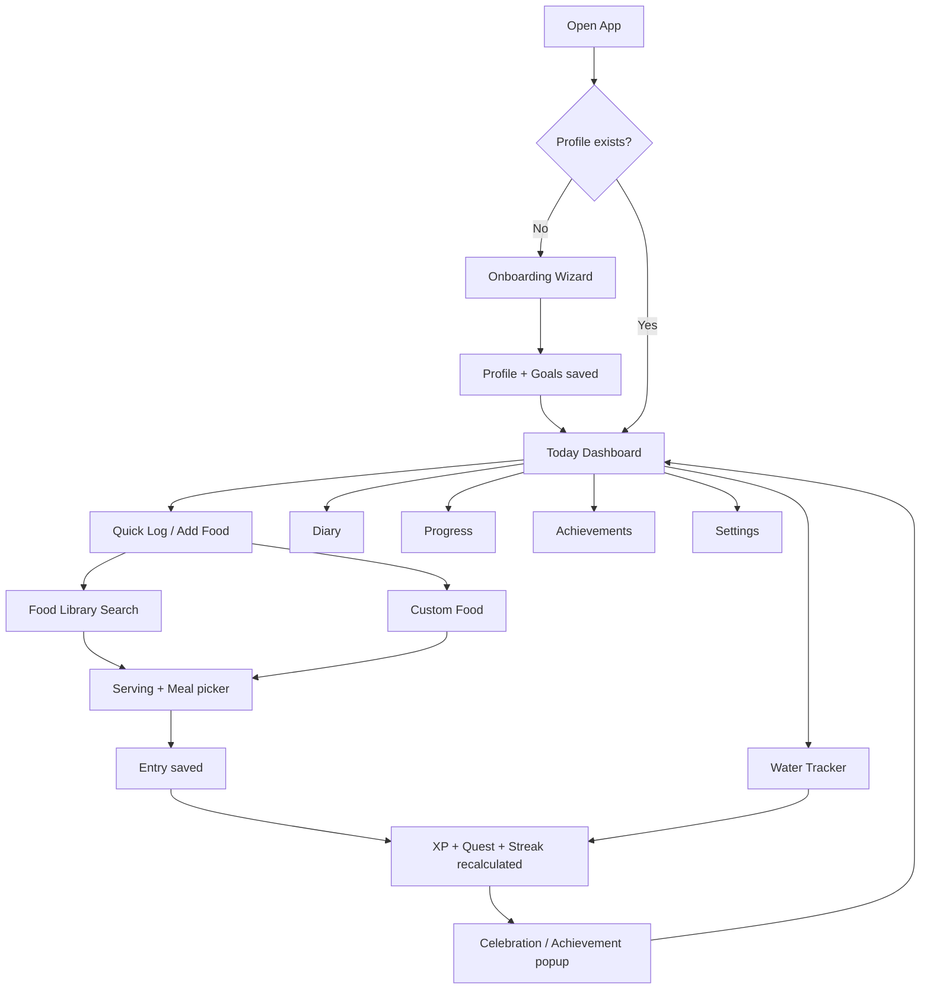
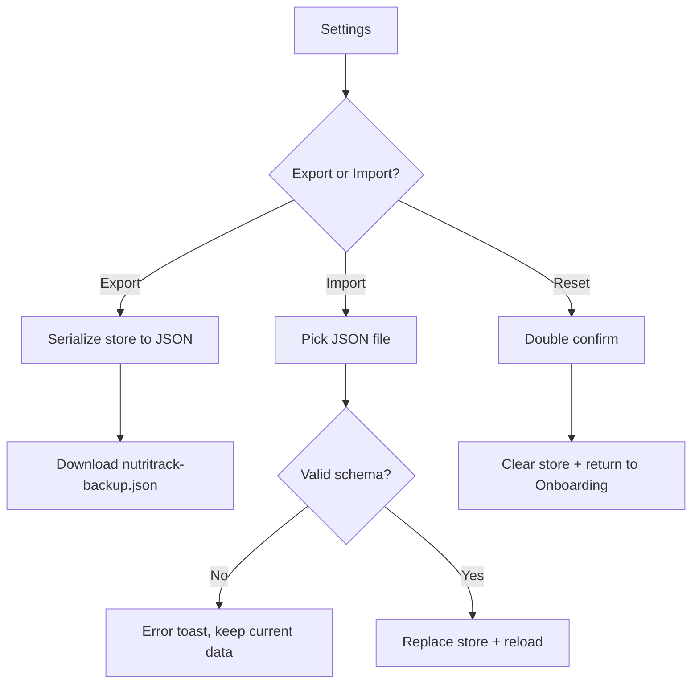

# NutriTrack — Product Requirements Document (PRD)

## 1. Product Overview

NutriTrack is a gamified, pixel-art food & habit tracker that turns everyday nutrition logging into a cozy, encouraging quest. Built **local-first** (no account, no server), it helps health-conscious everyday users and habit-building beginners log food, water, and daily goals — and feel rewarded for showing up.

- **Purpose**: make consistent nutrition tracking feel light, playful and worth returning to, without guilt or clinical judgement.
- **Audience**: (a) health-conscious everyday users who want awareness of habits; (c) beginners who need gentle guidance and streak-driven motivation.
- **Value**: a delightful, installable web app that works offline, stores everything in the browser, and rewards consistency with XP, levels, streaks, quests, achievements and a companion character.

## 2. Core Features

### 2.1 User Roles

| Role | Registration Method | Core Permissions |
|------|---------------------|------------------|
| Local User | None — first-run onboarding wizard creates a single local profile | Log/edit/delete own food & water, set goals, earn XP/achievements, export/import own data |

> No accounts, no cloud. All data lives in the browser (`localStorage` via a persisted store). A "Reset data" action is available in Settings.

### 2.2 Feature Module

1. **Onboarding wizard**: pixel intro, name + companion avatar pick, goal setup (kcal, macro split, water), quick tour.
2. **Today (Dashboard)**: energy ring, macro meters, water tracker, companion + level, XP bar, streak flame, daily quests, today's meals snapshot, daily insight, quick-log button.
3. **Diary**: date navigation, meals grouped by type (Breakfast/Lunch/Dinner/Snack) with subtotals, entry edit/delete, day summary, copy-yesterday.
4. **Add Food flow**: searchable food library, serving/quantity picker with live macro preview, choose meal, recently-used & favorites shortcuts, custom food creation.
5. **Food Library**: browsable/searchable seeded database (global + regional staples), category & macro filters, favorites, custom foods management.
6. **Progress**: weekly & monthly pixel charts (kcal trend, macro split, water), averages, streak calendar heatmap, goal-hit rate.
7. **Achievements & Quests**: badge grid (locked/unlocked with progress), level ladder with titles, daily quests, streak milestones, celebration popups.
8. **Settings**: profile & avatar, goals, units, theme (light/dark pixel), data export/import (JSON), reset, about.

### 2.3 Page Details

| Page Name | Module Name | Feature description |
|-----------|-------------|---------------------|
| Onboarding (`/onboarding`) | Intro step | Pixel hero + companion greeting; explains the world in one screen |
| Onboarding (`/onboarding`) | Profile step | Enter display name (2–20 chars), pick companion avatar from 6 pixel critters |
| Onboarding (`/onboarding`) | Goals step | Set daily kcal target (presets + custom), macro split (balanced / high-protein / low-carb / custom with live % validation summing to 100), water goal |
| Onboarding (`/onboarding`) | Finish step | Summary card, "Start my quest" CTA that seeds the store and grants the first achievement |
| Today (`/`) | Energy panel | Animated pixel ring showing kcal logged vs goal; remaining/over states with encouraging copy (never shaming) |
| Today (`/`) | Macro meters | Protein / Carbs / Fat chunky segmented bars with g values and % of goal |
| Today (`/`) | Water tracker | Pixel glass fills in stepped increments; +250 ml / +500 ml / custom / reset; goal celebration at target |
| Today (`/`) | Companion & level | Pixel companion sprite reacts to progress (idle / happy / thirsty / full); XP bar, level number, title |
| Today (`/`) | Streak & quests | Streak flame with day count; 3 daily quests with checkboxes auto-completing from logs |
| Today (`/`) | Meals snapshot | 4 meal cards with item count + kcal subtotal; empty-state prompts; tap to open Diary |
| Today (`/`) | Daily insight | Rotating non-judgemental tip card (reuses the demo's "no good/bad food" ethos) |
| Today (`/`) | Quick log | Floating "+" opens Add Food flow prefilled with a sensible meal by time of day |
| Diary (`/diary`) | Date navigator | Prev / next / today; blocks future dates; shows day summary totals |
| Diary (`/diary`) | Meal sections | Per-meal list of entries (name, qty, kcal, macros), edit inline, delete with undo toast |
| Diary (`/diary`) | Day summary | Total kcal, macros, water; delta vs goal; "Copy yesterday's meals" action |
| Add Food (modal) | Search | Debounced search over seeded + custom foods; empty/no-result states; barcode-free (offline) |
| Add Food (modal) | Serving picker | Choose unit/serving, quantity stepper, live per-entry macro preview |
| Add Food (modal) | Meal + time | Assign meal type (defaults by clock), optional note |
| Add Food (modal) | Custom food tab | Manual entry (name, kcal, protein, carbs, fat, optional fiber/serving) saved to library |
| Food Library (`/foods`) | Search & filters | Text search, category chips, sort; virtual-free list with pagination/scroll |
| Food Library (`/foods`) | Food cards | Per-100g or per-serving values, favorite toggle, "Log" shortcut, "New custom food" |
| Progress (`/progress`) | Range toggle | 7-day / 30-day selector |
| Progress (`/progress`) | Pixel charts | Bar chart (kcal/day with goal line), macro distribution, water bars — all custom pixel-style, no smoothing |
| Progress (`/progress`) | Averages | Averages vs goals with on-track/under/over chips |
| Progress (`/progress`) | Streak heatmap | Calendar grid of logged days, intensity by completeness |
| Progress (`/progress`) | Goal-hit rate | % of days kcal within target band, protein hit, water hit |
| Achievements (`/achievements`) | Badge grid | All achievements; locked show progress (e.g. 3/7); unlocked show date + shine |
| Achievements (`/achievements`) | Level ladder | Level number, title, total XP, XP to next level |
| Achievements (`/achievements`) | Quests | Today's quests, completed history, streak milestone tracker |
| Settings (`/settings`) | Profile | Edit name, swap companion |
| Settings (`/settings`) | Goals | Edit kcal/macros/water (same validation as onboarding) |
| Settings (`/settings`) | Units & theme | Metric/imperial weight-ish labels; light/dark pixel theme toggle |
| Settings (`/settings`) | Data | Export JSON (download), import JSON (file picker + validation), reset all (double confirm) |
| Not found (`*`) | 404 | Pixel "lost in the forest" screen with return-home action |

## 3. Core Process

**Main daily loop**: Open app → land on Today → see progress + quests → quick-log a meal (search food → pick serving → log) → water increments → XP/quest/streak/animation feedback → review Diary → check Progress later.

**First-run loop**: Open app → no profile → Onboarding wizard → goals saved → Today with welcome celebration and starter quests.

## 4. User Interface Design

### 4.1 Design Style

- **Concept**: "Cozy pixel pantry" — a warm, chunky 8-bit game HUD that happens to track nutrition.
- **Primary color**: deep forest green `#2F6B46` (energy, growth) with dark outline ink `#221A14`.
- **Secondary/accent colors**: warm cream base `#F7EFE1`, parchment panel `#FFFBF1`, amber `#E8A33D` (XP/streak flame), sky `#5FA8D3` (water), coral `#E2604A` (over-goal/warnings), plum `#8C6BB1` (achievements).
- **Dark theme**: ink base `#1B1714`, panel `#241E19`, same accents slightly desaturated — toggleable in Settings.
- **Buttons**: chunky rectangle with 3px solid ink border, hard offset shadow (4px, 4px, 0, ink); press state shifts the button into its own shadow (no blur). Rounded corners limited to 4–8px to stay pixel-crisp.
- **Typography**:
  - Headings / display: **Pixelify Sans** (readable pixel display).
  - Labels, numbers, data chips: **Silkscreen** (strict pixel caps).
  - Body copy: **Nunito** (rounded, legible, high x-height) — never Arial/Inter/system.
  - Base body 15–16px, labels 11–12px caps with letter-spacing, hero numerals 28–40px.
- **Layout**: top pixel "console bar" nav on desktop; bottom tab bar on mobile. Card/panel grid with visible 3px borders, no blur shadows, no glassmorphism. Dither/checkerboard textures and scalloped dividers for atmosphere.
- **Icons/sprite style**: UI icons from `lucide-react` (chunky stroke); food items, companion and decorations use pixel emoji/sprite tiles on a checkerboard tile background.
- **Texture & background**: cream base with subtle 8px checkerboard, dotted grid, and a soft vignette; scan-line-free to keep it warm.
- **Motion**: stepped/quantized animation only (`animation-timing-function: steps(n)`), sprite bobbing, pop-in modals, XP bar filling segment-by-segment, pixel-square confetti, sliding achievement toasts. No soft easing.

### 4.2 Page Design Overview

| Page Name | Module Name | UI Elements |
|-----------|-------------|-------------|
| Today | Energy panel | Large pixel ring (segmented arc, 12 steps), big kcal numeral (Silkscreen), remaining chip, encouraging caption, amber accent when on target |
| Today | Macro meters | 3 horizontal segmented bars, per-macro color (protein coral, carbs amber, fat plum), g + % labels |
| Today | Water tracker | Pixel glass sprite that fills in 5 steps, sky-blue fill, +/- buttons, goal stamp when complete |
| Today | Companion & level | Animated pixel critter (bob + blink), name tag, level badge, XP bar with segment ticks, level title |
| Today | Streak & quests | Flame badge with day count, 3 quest rows with pixel checkboxes, completion pop animation |
| Today | Meals snapshot | 4 tile cards, checkerboard food tile, subtotal, hover lift (hard shadow grows) |
| Today | Daily insight | Parchment card, small plant sprite, rotating tip text |
| Diary | Date navigator | Chunky prev/next arrows, big date label, "Today" pill |
| Diary | Meal sections | List rows with per-entry kcal, edit pencil, delete X, undo toast bar |
| Add Food | Modal | Slide-up pixel sheet, search field, result rows with kcal, sticky footer with preview + "Log it" button |
| Food Library | Filters | Category chips row, search bar, favorite star toggles |
| Progress | Charts | Pixel bar chart with dotted goal line, water bars, macro donut-as-blocks, axes in Silkscreen |
| Progress | Heatmap | Square calendar grid, 4 intensity levels of green |
| Achievements | Badge grid | 3-col grid of framed badges, locked = greyed with progress bar, unlocked = colored + shine sweep |
| Achievements | Level ladder | Vertical ladder with current rung highlighted, next title preview |
| Settings | Panels | Toggle switches (pixel), input fields with ink borders, danger zone in coral |
| 404 | Hero | Pixel "lost" scene, illustrated companion, "Back to camp" button |

### 4.3 Responsiveness

Desktop-first (primary target ≥1280px, centered max-width ~1180px, 2–3 column dashboard). Adaptive down to 360px: single column, bottom nav bar, modals become full-height sheets, charts scroll horizontally, tap targets ≥44px, quantity steppers enlarged for touch. Includes a web app manifest + installable/PWA-friendly meta so it can be added to a phone home screen.

### 4.4 3D Scene Guidance

Not applicable — the art direction is deliberately 2D pixel/sprite-based for performance, offline reliability and cohesive identity.
