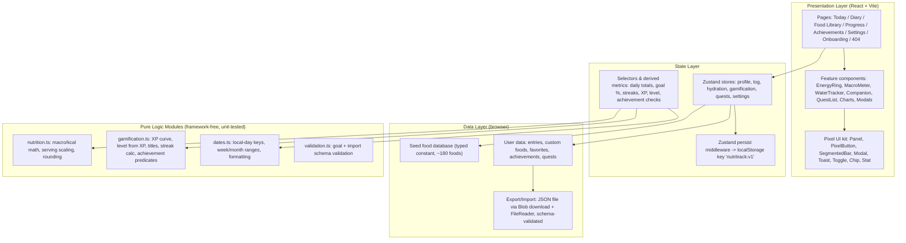
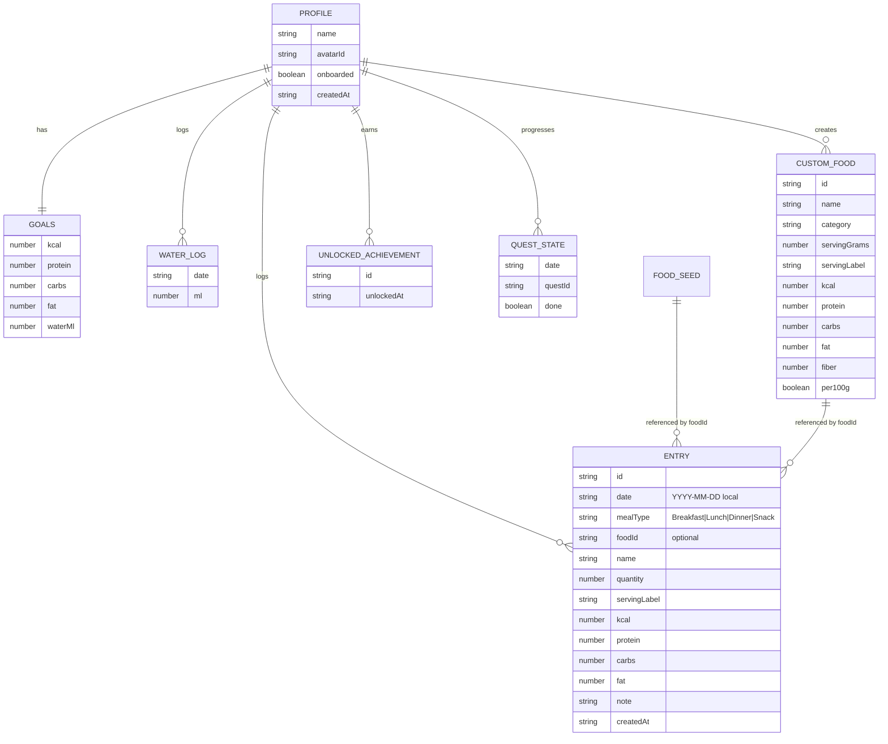

# NutriTrack — Technical Architecture Document

## 1. Architecture Design

Local-first, single-page application. No backend, no external services, no network dependency at runtime. All state lives in a persisted client store; the "data layer" is browser storage.



## 2. Technology Description

- **Frontend**: React@18 + TypeScript@5 + Vite@5 + tailwindcss@3
- **Initialization Tool**: `vite-init` with the `react-ts` template (pure frontend — no backend needed)
- **Routing**: `react-router-dom` v6 (static route elements, no lazy loading)
- **State management**: `zustand` (+ `persist` middleware) — the single source of truth, persisted to `localStorage`
- **Icons**: `lucide-react` (UI icons only); food/companion art uses pixel emoji/sprite tiles
- **Fonts**: Google Fonts — `Pixelify Sans` (display), `Silkscreen` (data labels), `Nunito` (body)
- **Charts**: hand-built pixel chart components (CSS/SVG rectangles) — deliberately no charting library, to preserve the stepped, non-smoothed aesthetic and keep the bundle small
- **Dates**: lightweight internal helpers in `src/utils/dates.ts` (avoid extra deps)
- **Testing**: `vitest` for the pure logic modules (`nutrition`, `gamification`, `dates`, `validation`)
- **No** backend, **no** Supabase, **no** Stripe, **no** auth provider, **no** network calls

### 2.1 Directory Structure

```
src/
  components/
    ui/            # Pixel UI kit: Panel, PixelButton, SegmentedBar, Modal, Toast, Toggle, Chip, Stepper, Ring
    layout/        # AppShell, TopNav, BottomNav, PageHeader
    today/         # EnergyPanel, MacroMeters, WaterTracker, Companion, StreakCard, QuestList, MealSnapshot, InsightCard
    diary/         # DateNavigator, MealSection, EntryRow, DaySummary
    food/          # FoodSearch, FoodRow, ServingPicker, CustomFoodForm, AddFoodSheet
    progress/      # PixelBarChart, PixelDonut, WaterBars, StreakHeatmap, StatGrid
    game/          # LevelLadder, AchievementGrid, AchievementToast, LevelUpOverlay
  pages/           # index.tsx (Today), Diary.tsx, Foods.tsx, Progress.tsx, Achievements.tsx, Settings.tsx, Onboarding.tsx, NotFound.tsx
  store/           # useAppStore.ts (slices), selectors.ts
  data/            # foods.seed.ts, achievements.seed.ts, quests.seed.ts, tips.seed.ts, avatars.ts
  hooks/           # useToday.ts, useDerivedDay.ts, useInterval.ts
  utils/           # nutrition.ts, gamification.ts, dates.ts, validation.ts, format.ts, storage.ts
  types/           # index.ts (all shared domain types)
  styles/          # globals.css (theme tokens, pixel utilities)
```

Shared types live in `src/types/index.ts` (frontend-only project, no `shared/` folder needed).

## 3. Route Definitions

| Route | Purpose |
|-------|---------|
| `/` | Today dashboard — the main hub |
| `/diary` | Diary with date navigation and per-meal entries |
| `/foods` | Food Library — search, filters, favorites, custom foods |
| `/progress` | Progress — charts, averages, streak heatmap |
| `/achievements` | Achievements, level ladder, quests |
| `/settings` | Settings — profile, goals, units, theme, data, reset |
| `/onboarding` | First-run wizard (full-screen, no app shell) |
| `*` | 404 not-found screen |

Route guards: an `AppShell` wrapper redirects to `/onboarding` when `profile.onboarded === false`; `/onboarding` redirects to `/` when already onboarded (unless opened with `?edit=1`).

## 4. API Definitions

Not applicable — there is no backend. The only "I/O" contracts are:

```ts
// Export file (downloaded)
interface BackupFile {
  app: "nutritrack";
  version: 1;
  exportedAt: string; // ISO
  data: PersistedState;
}

// Import result
type ImportResult =
  | { ok: true; data: PersistedState }
  | { ok: false; error: string };
```

## 5. Server Architecture Diagram

Not applicable — no server.

## 6. Data Model

### 6.1 Data Model Definition

Logical model (no physical DB; persisted as JSON in `localStorage` under `nutritrack:v1`).



### 6.2 Persisted State Shape (TypeScript)

```ts
type MealType = "Breakfast" | "Lunch" | "Dinner" | "Snack";

interface PersistedState {
  version: 1;
  profile: {
    name: string;
    avatarId: string;
    onboarded: boolean;
    createdAt: string;
  };
  goals: {
    kcal: number;
    protein: number; // g
    carbs: number;   // g
    fat: number;     // g
    waterMl: number;
  };
  entries: Entry[];
  water: Record<string, number>;        // date -> ml
  customFoods: CustomFood[];
  favorites: string[];                  // food ids
  gamification: {
    xp: number;
    logStreak: number;
    waterStreak: number;
    bestStreak: number;
    lastLoggedDate: string | null;
    unlocked: Record<string, string>;    // achievementId -> ISO date
    seenLevel: number;
  };
  quests: Record<string, string[]>;      // date -> completed quest ids
  settings: {
    theme: "light" | "dark";
    units: "metric" | "imperial";
    defaultMealAuto: boolean;
  };
}
```

### 6.3 Seed Data

- **`foods.seed.ts`** (~180 typed `Food` records): a general global set (fruits, vegetables, grains, proteins, dairy, drinks, snacks, fast food) **plus regional staples** relevant to the user's locale — e.g. jollof rice, fried rice, egusi soup, efo riro, pounded yam, garri/eba, amala, moi moi, akara, suya, pepper soup, plantain (dodo), beans (ewa), yam, cassava, ogbono, chin chin, puff puff, zobo, pap/ogi. Each record: `id, name, category, servingLabel, servingGrams, per100g { kcal, protein, carbs, fat, fiber }`.
- **`achievements.seed.ts`**: ~18 achievements with `id, title, description, icon, tier, predicate(currentStats)` — e.g. First Bite, Breakfast Club, Hydrated Hero, Protein Pro, 3/7/30-Day Streak, Variety Champ, Goal Setter, Level 5/10/20, Perfect Week, Night Owl, Early Bird.
- **`quests.seed.ts`**: daily quest pool (~10) with `id, title, xp, predicate(dayTotals, goals)` — 3 selected per day via a deterministic seed from the date.
- **`tips.seed.ts`**: ~20 non-judgemental insight/tip strings.
- **`avatars.ts`**: 6 pixel companions (emoji + palette) with names.

### 6.4 Derived Logic Rules (pure, testable)

- **Daily totals**: sum `entries` where `date === today`; water from `water[today]`.
- **XP awards**: +10 per logged entry, +25 per full macro-complete day (all four goals ±10%), +15 water goal hit, +5 per favorite food logged first time; quest XP from `quests.seed`.
- **Level curve**: `level = floor(sqrt(xp / 60)) + 1`; `xpForLevel(n) = 60 * (n - 1)^2`; titles ladder (Sprout → Sapling → Seedling → Bloom → Grove → Orchard → Harvest → Legend).
- **Streaks**: computed lazily on app open — if `lastLoggedDate === yesterday` and today not logged, streak persists; if gap > 1 day, reset to 0. Same pattern for water streak.
- **Achievements**: evaluated after every mutation; newly satisfied predicates pushed to `unlocked` and queued as toasts.
- **Goal band**: "on target" when total kcal is within ±10% of goal; protein hit when `protein >= goal * 0.9`.
- **Rounding**: display kcal as integers; macros to 1 decimal only under 10g, else integer.

### 6.5 State Management Guidelines

```ts
// store/useAppStore.ts
export const useAppStore = create<AppState>()(
  persist(
    (set, get) => ({
      ...initialState,
      addEntry: (input) => {
        const entry = buildEntry(input); // pure: scales serving -> macros
        set((s) => ({ entries: [...s.entries, entry] }));
        recheckGamification(set, get); // XP, streaks, quests, achievements (pure predicates)
      },
      addWater: (ml) => { /* clamp, recheck water quest + achievement */ },
      reset: () => set(() => structuredClone(initialState)),
      // ...
    }),
    { name: "nutritrack:v1", version: 1, migrate: migrateBackup }
  )
);
```

- All domain math lives in `src/utils/*` as pure functions and is unit-tested with Vitest; the store only orchestrates.
- Components read via narrow selectors to avoid needless re-renders; derived day metrics come from `useDerivedDay()`.
- No component exceeds ~300 lines; heavy pages are composed from `src/components/<feature>/` subcomponents.

## 7. Verification Plan

1. `npm run check` (tsc) — zero type errors.
2. `npm run test` — Vitest suites for `nutrition`, `gamification`, `dates`, `validation` all green.
3. `npm run dev` — start dev server in background and open preview.
4. Browser verification via Puppeteer MCP: complete onboarding → log a food → add water → confirm XP/quest/level/streak feedback → navigate all routes → toggle theme → export/import → reset.
